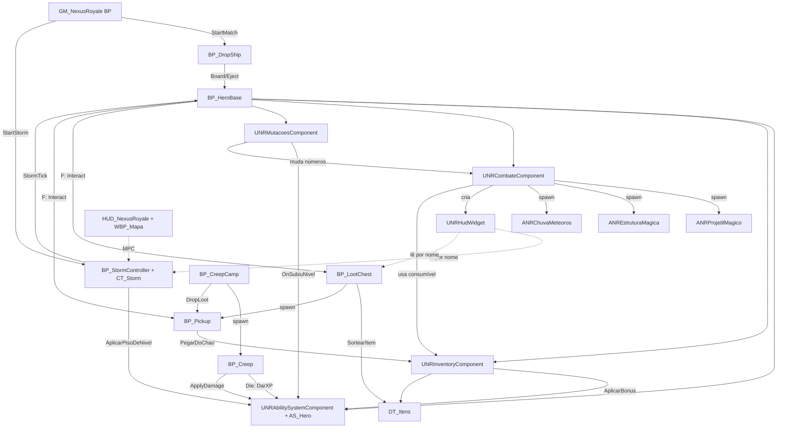

# Auditoria do projeto (Marco 0)

Feita em 2026-10-15, das 19:40 às 20:10 (Brasília), por Claude (Claude Code), a pedido do usuário (prompt "Lead Game
Architect"). É a foto do projeto **antes** da nova direção (multiplayer de 20 jogadores com draft de habilidades).

**Como foi feita:** leitura do C++ (29 arquivos, 4.826 linhas), das 58 DSLs de Blueprint (`Unreal/Blueprints/`), dos
73 scripts de `Unreal/`, das configurações, do git, do [AGENTS.md](../../AGENTS.md), do [PLANO.md](../../PLANO.md), do
[GDD v2](../../Design/GDD_v2.md) e do [Mapa.md](../../Design/Mapa.md).

**Limite:** a Unreal estava fechada e o MCP da Unreal não conectou nesta sessão. Nenhum asset foi aberto no editor. O
conteúdo dos `.uasset` foi deduzido dos scripts que os geram, das DSLs e dos testes registrados no AGENTS.md. O que
depende de abrir o editor está marcado como **sem verificar no editor**.

---

## 1. Resumo em 6 linhas

1. O **loop solo funciona** no editor (PIE) e no jogo empacotado: dirigível → salto → baús → creeps → XP e nível →
   mutações → tempestade → morte → a partida recomeça.
2. **Não há multiplayer.** Só os atributos do GAS e algumas variáveis da tempestade, do dirigível e do loot replicam.
   Combate, inventário, interação, salto e mutações rodam no cliente local. Num cliente conectado, quase nada funcionaria.
3. **A versão publicada (0.1.1) está quebrada:** as teclas de combate não foram salvas no `IMC_Default` (bug 1.9 do
   PLANO.md). No jogo instalado, não dá para atacar, abrir baú nem escolher mutação.
4. **O design pedido agora é outro em pontos centrais:** draft de habilidades únicas, 2 slots de arma, 6 slots de item
   (Z X C V B N), 1 ponto de atributo por nível, lobby de 20 vagas com bots. O GDD v2 tem arquétipos, 20 pontos na
   montagem, grimórios para E/R e mutações. A comparação está em [DECISIONS.md](DECISIONS.md), D-002.
5. **Faltam do zero:** menus, sessões, lobby, staging, draft, armas, bots, áudio, Niagara, ESC/configurações, telemetria.
6. **O que vale ouro e deve ficar:** o C++ do GAS (atributos, efeitos, dano), a tempestade por tabela, o dirigível, os
   creeps com corrente e drop, o pipeline Quaternius, o release com launcher, e as ferramentas (MCP, Python remoto, DSL,
   scripts de teste do PIE).

## 2. Inventário dos sistemas

Legenda de estado: **OK** funciona e foi testado · **Parcial** funciona em parte · **Quebrado** · **Falta**.
Rede: **Sim** replicado/autoritativo · **Parcial** · **Não**.

| Sistema | Onde | Estado | Rede | Observação |
|---|---|---|---|---|
| Engine e projeto | UE 5.8.3, `Unreal/NexusRoyale`, módulo C++ `NexusRoyale` | OK | — | Plugins: GameplayAbilities, GameplayStateTree (ativo, sem uso), MCP, AllToolsets, Python, Terminal, ModelingTools. **Nenhum plugin de Online Subsystem** |
| Fluxo da partida | `GM_NexusRoyale` (BP, filho do `BP_ThirdPersonGameMode` do template) | Parcial | Parcial | Aos 0,5 s cria o dirigível, embarca todos os heróis e liga a tempestade. Sem fases, sem vitória, sem fim. O GameMode global do projeto ainda é o do template (com o `BP_Hero_Brakka` da v1) |
| GameState / PlayerState | padrão da engine | Falta | — | Nenhum estado de partida ou de jogador replicado (abates, vivo, nível, colocação) |
| PlayerController | `BP_ThirdPersonPlayerController` (template) | Parcial | — | Só adiciona o IMC. Sem menus, sem espectador |
| Herói | `BP_HeroBase` (Character) | OK (solo) | Parcial | Corpo + roupa + cabelo Quaternius; componentes `Habilidades`, `Inventario`, `Combate`, `Mutacoes`; salto do dirigível e planagem; F interage. Movimento replica (CharacterMovement); o resto não |
| GAS: atributos | `GAS/AS_Hero`, `GAS/NRAbilitySystemComponent` | OK | Sim (atributos) | 18 atributos replicados + 3 meta (Dano, DanoVerdadeiro, Cura). Armadura, regeneração, combate. **`Nivel` e `XP` não replicam.** ASC fica no Character, não no PlayerState |
| GAS: habilidades | — | Falta | — | Nenhuma `GameplayAbility`, nenhuma Gameplay Tag definida. Efeitos são C++ com SetByCaller (`GAS/NRGameplayEffects`) |
| Combate | `Combat/UNRCombateComponent` | OK (solo) | **Não** | Dardo, Bola de Fogo (Q), Muralha de Gelo (E), Chuva de Meteoros (X), consumíveis 1-3, morte. Tudo a partir do input local, sem RPC. Na morte, `OpenLevel` do mesmo mapa (num multiplayer, derrubaria a conexão) |
| Atores das magias | `ANRProjetilMagico`, `ANREstruturaMagica`, `ANRChuvaMeteoros` | OK (solo) | **Não** | Não marcam `bReplicates`. O dano só acontece com autoridade, mas quem cria o ator é o input local |
| Inventário | `Items/UNRInventoryComponent` | OK (solo) | **Não** | 4 de equipamento, 3 de consumível, 2 grimórios. Nada replica |
| Itens | `DT_Itens` (de `Unreal/Data/DT_Itens.csv`, 33 linhas) | OK | — | Equipamentos, consumíveis e grimórios do GDD v2 §8 |
| Mutações | `Progression/UNRMutacoesComponent` | OK (solo) | Parcial | Escolha só com autoridade, mas chamada pelo input local; opções não replicam |
| XP e nível | no ASC (`GanharXP`, `DarXP`, piso de nível) | OK (solo) | **Não** | Curva do GDD v2 §7.1; piso pela tempestade |
| HUD | `UI/UNRHudWidget` (C++, monta o layout sozinho) | OK | Parcial | Lê os componentes do pawn local. Lê o `BP_StormController` e o `Prompt` dos interativos **pelo nome da variável** (frágil) |
| Mapas da interface | `WBP_Mapa`, `HUD_NexusRoyale` (AHUD), `MPC_Mapa`, `M_UI_Mapa` | OK | — | Minimapa, M e mapa da queda. O fundo é o desenho da ilha v2, não o `L_Island` |
| Tempestade | `BP_StormController` + `CT_Storm` | OK | **Sim** | Melhor exemplo de rede do projeto: `StartTime`, `bStarted` e centros replicados; relógio pelo `ServerWorldTimeSeconds`; dano no servidor |
| Dirigível | `BP_DropShip` | OK (solo) | Parcial | Rota replicada; o salto (`Eject`) é chamado pelo input local, sem RPC |
| Baús e pickups | `BP_LootChest`, `BP_Pickup`, `BP_Interactable` | OK (solo) | Parcial | Replicam variáveis, mas o sorteio roda onde o `Interact` é chamado, que é o input local. Num cliente, o RNG seria do cliente |
| Creeps | `BP_Creep`, `_Imp`, `_Puglin`, `BP_CreepCamp` | OK (solo) | Parcial | Criados no servidor, `Think` no servidor. Character replica movimento por padrão, mas vida, animação de golpe e de morte não replicam (sem verificar). Sem NavMesh: andam em linha reta |
| Níveis | `L_Island` (padrão, 400 m), `L_Ilha` (v2, 1 km, sem Landscape), `Lvl_ThirdPerson` | Parcial | — | O `L_Ilha` espera o usuário importar o Landscape. Nenhum é World Partition (só o do template) |
| Input | Enhanced Input, `IMC_Default` | **Quebrado** | — | No disco só há pulo, câmera, movimento e mapa. Sem remapeamento pelo jogador |
| Render | `DefaultEngine.ini` sem Lumen/VSM/DF; `M_PP_CartoonAquarela`, `M_PP_Cel`; stencil por tipo de ator | Parcial | — | Visual de aquarela por pós-processamento. Nanite desligado em 159 malhas (mudança **sem commit**) |
| VFX | esferas unlit + luz | Parcial | — | Nenhum sistema Niagara do projeto |
| Áudio | — | Falta | — | Nenhum som no projeto |
| Menus, lobby, sessões, ESC, configurações | — | Falta | — | O jogo abre direto no `L_Island` |
| Bots | — | Falta | — | |
| Telemetria | — | Falta | — | Só o log da Unreal |
| Release e launcher | `Unreal/ue_release.py`, `Launcher/NexusRoyaleLauncher.cs` | OK | — | 0.1.0 e 0.1.1 publicadas; atualização automática testada |
| Ferramentas | `ue_py.py`, `ue_tool.py`, `ue_write_dsl.py`, `pie_*.py`, hooks de registro | OK | — | Permitem mexer e testar a Unreal por script. Preservar |
| Blender | `Blender/scripts/*` | Obsoleto | — | Geram assets da v1. O pipeline atual é Quaternius → Unreal por script |
| Balanceamento | `Design/Simulacao_TTK.xlsx`, `CT_Storm.csv`, `DT_Itens.csv` | OK | — | TTK do GDD v2 (sem armas) |

## 3. Classificação

### O que já funciona
- GAS: atributos, armadura, dano, cura, regeneração, "em combate", bônus de itens (C++).
- Loop solo completo, testado em PIE e no jogo empacotado (com o bug das teclas na 0.1.x).
- Tempestade por tabela, com relógio do servidor e dano percentual.
- Dirigível com rota sorteada, salto e planagem.
- Creeps com aggro, corrente, golpe, morte, XP, drop e reaparecimento; batem na Muralha de Gelo.
- Loot por tabela de dados (`DT_Itens`) e raridade.
- HUD com relógio da tempestade, "fora da zona", prompt do F, mutações e minimapa.
- Empacotamento, Release no GitHub e launcher com atualização automática.

### Parcial
- Rede: só atributos, tempestade, rota do dirigível e variáveis de loot.
- Visual: aquarela por pós-processamento; sem materiais pintados nem iluminação de humor.
- Mapa v2: layout e materiais prontos, sem Landscape.

### Quebrado
- `IMC_Default` sem as teclas de combate no disco (0.1.0 e 0.1.1). Causa e correção no PLANO.md, item 1.9.
- A tag `v0.1.1` aponta para o `2ff3965`, não para o commit do código da 0.1.1 (`b63f296`).

### Preservar
- `AS_Hero` + `UNRAbilitySystemComponent` (base da progressão e do dano).
- `BP_StormController` + `CT_Storm` (modelo de rede certo).
- `BP_DropShip`, `BP_Creep*`, `BP_CreepCamp`, `BP_LootChest`, `BP_Pickup` (comportamento; ganham rede).
- `UNRInventoryComponent` (vira a base dos 6 slots).
- `UNRHudWidget` (vira a base do HUD; ganha widgets novos).
- Pipeline Quaternius, release, launcher e ferramentas.

### Refatorar
- **Combate** (`UNRCombateComponent`): vira Gameplay Abilities com dados (M5). Não vale pôr RPC nele antes.
- **Interação, salto e loot**: chamadas no servidor (RPC no PlayerController ou no herói).
- **Inventário**: replicar (dono vê tudo; os outros veem só as armas na mão) e trocar o layout de slots.
- **XP, nível, abates**: para o PlayerState, replicados.
- **Morte**: em vez de `OpenLevel`, o GameMode decide (espectador, vitória).
- **HUD**: parar de ler variáveis de Blueprint pelo nome; ler do GameState e de interfaces C++.
- **Atributos da build**: se o sistema de pontos mudar (D-005), mudar o `AS_Hero`.

### O que falta
Menus, sessões (hospedar e entrar), lobby de 20 vagas, bots, staging, draft, armas, 6 slots de item, morte com espectador
e vitória, ESC sem pausa, configurações e remapeamento, áudio, Niagara, telemetria, teste com 20 jogadores.

## 4. Riscos de escala (20 jogadores)

| Risco | Por quê | O que fazer |
|---|---|---|
| Input local cria atores e aplica efeitos | Num cliente, magia e loot não existiriam para os outros, e o RNG seria do cliente | M2 e M5: tudo que muda estado passa pelo servidor |
| ASC no Character | O que é da partida inteira (draft, abates, colocação) some com o pawn | Guardar identidade no PlayerState (D-005) |
| HUD lê BP pelo nome | Renomear uma variável apaga o texto sem erro | Interfaces C++ e GameState |
| Creeps sem NavMesh e sem LOD de IA | ~70 creeps pensando a cada 0,3 s no servidor de quem hospeda | Acampamento dorme sem herói por perto; NavMesh no mapa v2 |
| Uma Character por creep replicando | Custo de banda e de CPU do servidor | Frequência de rede baixa, distância de corte, dormência |
| Loot como um ator por item | Cada morte soltaria até 8 atores | Bolsa única na morte (D-009); baú dormente até abrir |
| PC de desenvolvimento fraco (RX 570, 16 GB, HD mecânico) | O editor cai no 2º PIE; 20 clientes não cabem | Clientes sem render (`-nullrhi`) e bots para o teste de 20 (TEST_PLAN.md) |
| Host como servidor | Vantagem de latência e de informação; cai a partida se ele sair | Regras longe da UI; caminho para servidor dedicado (NETWORKING_ARCHITECTURE.md) |

## 5. Mapa de dependências (hoje)

## 6. Dívida técnica

| Dívida | Onde | Custo de deixar |
|---|---|---|
| Teclas não salvas no IMC | `Unreal/ue_mvp_setup.py` | Jogo publicado sem combate |
| GameMode global do template com herói da v1 | `DefaultEngine.ini` | Mapa novo sem override abre o Brakka |
| `bUseSplitscreen=True` | `DefaultEngine.ini` | Irrelevante agora; desligar quando houver vários jogadores locais de teste |
| Morte faz `OpenLevel` | `UNRCombateComponent::Recomecar` | Incompatível com multiplayer |
| Mutações e magias fixas em `enum`/`switch` | `UNRMutacoesComponent`, `UNRCombateComponent` | Não escala para 128 habilidades |
| Restos da v1 | `BP_Hero_*`, `SK_Guardian`, `SM_Build_*`, torres, Nexus; `Blender/scripts/build_all.py`, `import_nexus_assets.py`, `Export/map_layout.json` | Confusão e tamanho do cook |
| Cópia da ilha com redirector | `Content/NexusRoyale/Map/_tmp/` | Asset duplicado |
| 159 malhas com Nanite desligado sem commit | `Content/Quaternius`, `Content/LevelPrototyping` | Risco de perder ou de commitar sem querer |
| Números de balanceamento espalhados | defaults de BP (creeps), structs C++ (magias), CSVs | Difícil balancear (ver BALANCE.md) |
| Fundo do minimapa é a ilha v2 | `T_Mapa_UI` | Nomes errados no `L_Island` |
