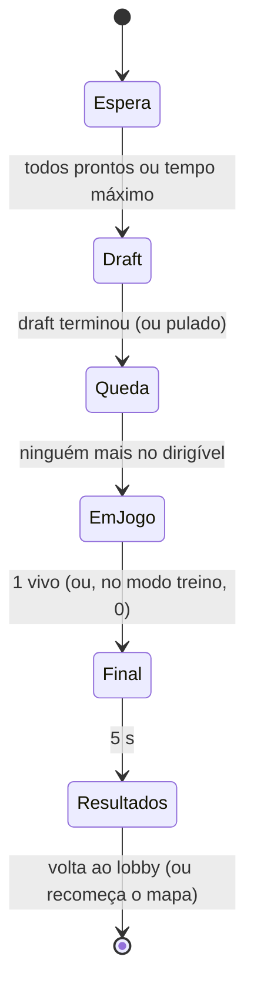

# Sistemas de jogo

Como cada sistema funciona **hoje** e como deve funcionar. Habilidades no [ABILITY_SYSTEM.md](ABILITY_SYSTEM.md); itens
e loot no [ITEM_AND_LOOT_SYSTEM.md](ITEM_AND_LOOT_SYSTEM.md); IA no [AI_AND_BOTS.md](AI_AND_BOTS.md); números no
[BALANCE.md](BALANCE.md).

---

## 1. Máquina de estados da partida (M1)

**Hoje:** o `GM_NexusRoyale` espera 0,5 s, cria o dirigível, embarca todos e liga a tempestade. Não há fim: a morte
recarrega o mapa no próprio cliente.

**Desde o M1 (15/10):** `ANRGameMode` (só servidor) decide as transições; `ANRGameState` replica. Testado em PIE, com
bots de teste e em rede (TEST_PLAN.md §5).

| Fase | Entra quando | O servidor faz | Sai quando |
|---|---|---|---|
| **Espera** | o mapa da partida começa | espera os humanos (`JogadoresEsperados`, D-016) terem herói | todos chegaram e passou o tempo mínimo (3 s), ou o tempo máximo (60 s) |
| **Draft** | fim da Espera | roda o `UNRDraftComponent` (M6). **Até o M6, a fase é pulada** | o draft termina |
| **Queda** | fim do Draft | evento `AoEntrarNaFase(Queda)` no `GM_NexusRoyale`: cria o dirigível, embarca os heróis, liga a tempestade (o `StartMatch` de hoje) | nenhum herói está mais no dirigível |
| **EmJogo** | fim da Queda | escuta eliminações; conta os vivos | vivos ≤ 1 (partida normal) ou o único jogador morreu (modo treino) |
| **Final** | condição de vitória | define o `Vencedor`, congela o combate, mostra vitória/colocação | 5 s |
| **Resultados** | fim do Final | mostra a tabela | 15 s → lobby (M4) ou `RestartGame` (antes do M4) |

**Replicado no `ANRGameState`:** `Fase`, `InicioDaFase`, `FimDaFase` (horário do servidor; 0 = sem prazo), `Vencedor`
(PlayerState), `JogadoresNoInicio`. Os vivos são contados nos PlayerStates (nunca um contador solto).

**Modo treino:** se a partida começou com **1 jogador** (desenvolvimento), ela não termina quando ele é "o último vivo";
termina quando ele morre (derrota), e recomeça o mapa. Assim o loop solo de hoje continua igual.

**Regras:**
- Toda transição passa por uma função só (`MudarFase`), que registra no log e na telemetria.
- A vitória dispara **uma vez**: depois do Final, novas eliminações são ignoradas.
- Nada de timer solto em Blueprint para mudar de fase.

## 2. Entrada de jogadores

- **Hoje:** cada jogador nasce num PlayerStart da ilha. Quem chega da Queda em diante vira espectador (D-015, M1).
  Bots de teste entram por `ANRGameMode::AdicionarBotDeTeste` (D-017).
- **Alvo:** nasce na **Ilha de Espera** (D-006) até a Queda. Bots entram pelo lobby (M4) com PlayerState próprio.

## 3. Eliminação, espectador e vitória (núcleo no M1, acabamento no M14)

Fluxo no servidor, quando a vida de um herói chega a 0 (implementado no M1, menos a bolsa de loot):

1. O ASC marca morto e avisa (`OnMorreu` para o Blueprint, `OnMorreuNativo` para o GameMode).
2. `ANRGameMode::EliminarJogador(Vitima, Assassino)`:
   - ignora se a fase não é Queda/EmJogo ou se a vítima já foi eliminada;
   - marca `bVivo = false` e a **colocação** (= vivos antes da morte);
   - soma 1 abate ao assassino e dá o **XP de abate** (BALANCE.md, §4);
   - solta a bolsa de loot (M9);
   - grava na telemetria;
   - confere a vitória.
3. O controle da vítima é desligado; depois de 3 s a câmera passa para quem matou (ou para um vivo). Espectador
   completo (trocar de alvo, sem informação extra) no M14.

**Combate congelado no Final:** todos os heróis ficam sem input e sem receber dano.

## 4. XP e nível

- **Hoje (existe):** `UNRAbilitySystemComponent.GanharXP` com a curva do GDD v2 §7.1; creeps dão XP no `Die`
  (`DarXP`); piso de nível no fim de cada fase da tempestade (`AplicarPisoDeNivel`).
- **M1:** XP de abate de jogador. O `ANRPlayerState` espelha `Nivel` e `XP` (replicados) para HUD, placar e espectador.
- **M11:** pontos de atributo por nível e mutações só nos níveis 3, 6 e 9 (⚑ D-002e).

## 5. Zona (existe)

- `BP_StormController` + `CT_Storm` (6 fases). Relógio pelo horário do servidor; centros sorteados no servidor e
  replicados; dano a cada 1 s no servidor (`StormTick` → `AplicarDanoTempestade`, % da vida máxima, sem armadura).
- **Alvo:** começa na fase Queda (como hoje); o HUD lê a zona por uma interface C++ (`INRZona`) em vez de variáveis pelo
  nome; raios para a ilha v2 quando ela for o mapa (proposta em Design/Mapa.md).

## 6. Queda (existe, sem rede)

- `GM_NexusRoyale.StartMatch` sorteia a rota; `BP_DropShip` voa, carrega os heróis e solta. Espaço salta (só sobre a
  ilha); queda a −26 m/s, planagem a −4,5 m/s a 30 m do chão.
- **M2:** `Server_Saltar` (hoje o input chama `Eject` direto). Ao fim da rota, o servidor solta quem sobrou.
- **M12:** rota em `DA_Queda`; a câmera e o mapa da queda mostram a rota (já mostram).

## 7. Interação e loot (existe, sem rede)

- `BP_Interactable` avisa o herói ao entrar na esfera; F chama `Interact` no alvo. Baú sorteia por `DT_Itens` e cria
  pickups; pickup chama `UNRInventoryComponent.PegarDoChao`.
- **M2:** F vira `Server_Interagir(Alvo)` com validação de distância e fase; o sorteio passa a rodar no servidor.
- **M9:** tabelas de loot (`DT_Loot`), 6 slots, bolsa da morte.

## 8. Creeps (existe)

- `BP_CreepCamp` cria os creeps no servidor; `BP_Creep.Think` a cada 0,3 s: aggro 7 m, corrente 15 m, bate na Muralha
  que bloqueia, avisa o acampamento ao levar dano, dá XP e drop ao morrer, reaparece.
- **M2:** conferir a replicação (movimento já replica pelo Character); replicar vida e morte para os clientes.
- **M10:** acampamento dorme sem herói por perto; tipo à distância; elite; dados em `DT_Creeps`; NavMesh no mapa v2.

## 9. Combate (existe; vira GAS no M5)

- Hoje: `UNRCombateComponent` (dardo, Q, E, X, consumíveis) no input local. Ver [ABILITY_SYSTEM.md](ABILITY_SYSTEM.md).

## 10. Resultados (M14)

Tabela com colocação, abates, dano causado e recebido, nível, habilidades do draft, armas, e quem eliminou quem. Os
números vêm do `ANRPlayerState` e da telemetria da partida.
