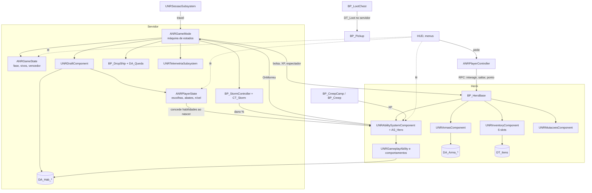

# Arquitetura técnica

Como o código de hoje ([AUDITORIA.md](AUDITORIA.md)) evolui até o jogo do [GAME_DESIGN_DOCUMENT.md](GAME_DESIGN_DOCUMENT.md).
Regras de rede no [NETWORKING_ARCHITECTURE.md](NETWORKING_ARCHITECTURE.md). Decisões numeradas no [DECISIONS.md](DECISIONS.md).

**Estado deste documento:** alvo + plano de migração. O que já existe está marcado **(existe)**; o resto é proposta
dos marcos do [MASTER_PLAN.md](MASTER_PLAN.md).

---

## 1. Princípios

1. **Servidor decide, cliente pede.** Toda regra roda com autoridade. O host não é especial (D-003).
2. **Regras em código, números em dados.** C++ e Blueprint executam; Data Assets, DataTables e CurveTables guardam
   números e conteúdo (D-008).
3. **Componentes, não um herói gigante.** O `BP_HeroBase` monta componentes; cada componente cuida de um assunto.
4. **Uma fonte de verdade por dado.** Ex.: o nível mora no ASC (servidor) e é espelhado no PlayerState para os outros;
   ninguém mais guarda nível.
5. **UI só lê.** Widgets leem GameState, PlayerState e componentes; mudam o jogo apenas pedindo ao servidor.
6. **Migrar aos poucos.** Nada que funciona é reescrito sem um marco que diga por quê.

## 2. C++ ou Blueprint

| C++ | Blueprint / dados |
|---|---|
| Máquina de estados da partida, GameState, PlayerState, PlayerController | Montagem visual do herói, dos creeps, dos baús |
| Sessões, telemetria, configurações | Layout de UI (WBP sobre bases C++) |
| GAS: AttributeSet, efeitos mecânicos, classes de comportamento das habilidades | Configuração de cada habilidade, arma, item (Data Assets e tabelas) |
| Inventário, armas (replicação com Fast Array) | Ganchos de VFX e som |
| Draft (estado e regras) | Tarefas simples de IA e scripts de nível |
| Partes caras de IA (percepção, escolha de alvo) | Creeps (o `Think` atual fica até o M10) |

## 3. Classes alvo

Pasta `Unreal/NexusRoyale/Source/NexusRoyale/`. Prefixo `NR`. Nomes de funções em português, como o código existente.

| Pasta | Classe | Papel | Marco |
|---|---|---|---|
| `Core/` | `ANRGameMode` **(existe, M1)** | Só no servidor. Máquina de estados da partida, entrada de jogadores e bots, eliminação, vitória | M1 |
| `Core/` | `ANRGameState` **(existe, M1)** | Replica a fase, o horário do servidor em que ela termina, os vivos, o vencedor | M1 |
| `Core/` | `ANRPlayerState` **(existe, M1; sem as escolhas do draft)** | Replica nome, bot, pronto, vivo, abates, nível e XP (espelho), colocação, escolhas do draft | M1 |
| `Core/` | `ANRPlayerController` | Pedidos ao servidor (interagir, saltar, distribuir ponto), espectador, menus locais (ESC). No M1 o PC continua o do template (`BP_ThirdPersonPlayerController`) | M2 |
| `AI/` | `ANRBotController` **(existe desde o M1, mínimo)** | Bot que ocupa vaga, com PlayerState; o cérebro vem no M15 | M1, M15 |
| `Core/` | `UNRSessaoSubsystem` **(existe desde o M1, mínimo)** | Hoje guarda os humanos esperados no recomeço (D-016); no M3, hospedar, procurar, entrar, sair (D-010) | M1, M3 |
| `Core/` | `UNRTelemetriaSubsystem` | Eventos da partida em JSON Lines (D-013) | M14 |
| `Core/` | `UNRGameUserSettings` | Vídeo, áudio, sensibilidade, câmera | M16 |
| `Lobby/` | `ANRLobbyGameMode`, `ANRLobbyGameState` | 20 vagas, bots, opções, começar | M4 |
| `Draft/` | `UNRDraftComponent` (no GameState) | Estado do draft replicado e regras no servidor | M6 |
| `Draft/` | `UNRDraftFormato` (Data Asset) | Faixas, janelas, rodadas, fator do pool (D-007) | M6 |
| `Abilities/` | `UNRGameplayAbility` | Base: custo, recarga, telegrafia, liberação por nível | M5 |
| `Abilities/` | `UNRGA_Projetil`, `UNRGA_AreaComAviso`, `UNRGA_Estrutura`, `UNRGA_Avanco`, `UNRGA_Buff`, `UNRGA_Passiva` | Comportamentos genéricos configurados por dados | M5, M21 |
| `Abilities/` | `UNRAbilityDefinition` (Primary Data Asset) | Uma por habilidade: tag, tipo, categorias, ícone, textos, custo, recarga, comportamento, parâmetros | M5 |
| `Abilities/` | `NRGameplayTags` | Tags nativas (`Ability.*`, `Effect.*`, `State.*`, `Damage.*`) | M5 |
| `GAS/` | `UAS_Hero` **(existe)**, `UNRAbilitySystemComponent` **(existe)**, `NRGameplayEffects` **(existe)** | Atributos, dano, cura, XP e nível | M5/M11 (ajustes) |
| `Weapons/` | `UNRWeaponDefinition` (Primary Data Asset), `UNRArmasComponent`, `UNRGA_DispararArma`, `UNRGA_GolpeArma` | 2 slots de arma, disparo pelo servidor | M8 |
| `Items/` | `UNRInventoryComponent` **(existe)** | Vira 6 slots genéricos, replicado ao dono | M9 |
| `Items/` | `ANRBolsaDeLoot` | Bolsa da morte (D-009) | M9 |
| `Combat/` | `UNRCombateComponent` **(existe)** | Encolhe: as magias saem para GA no M5; fica a morte e o HUD até o M14 | M5 |
| `Combat/` | `ANRProjetilMagico`, `ANREstruturaMagica`, `ANRChuvaMeteoros` **(existem)** | Reaproveitados pelas GA genéricas, com `bReplicates` | M5 |
| `Progression/` | `UNRMutacoesComponent` **(existe)** | Passa a oferecer só nos níveis marcados; mutações de habilidade vêm dos dados | M11 |
| `Progression/` | `UNRAtributosComponent` ou funções no ASC | Pontos por nível e distribuição (pedido ao servidor) | M11 |
| `AI/` | `ANRBotController`, tarefas de StateTree | Bots (D-012) | M15 |
| `UI/` | `UNRHudWidget` **(existe)** + bases C++ dos menus | HUD e telas | M3, M16 |

**Blueprints que continuam:** `BP_HeroBase` (visual, pulo do dirigível), `GM_NexusRoyale` (filho do `ANRGameMode`),
`BP_StormController`, `BP_DropShip`, `BP_LootChest`, `BP_Pickup`, `BP_Creep*`, `BP_CreepCamp`, `HUD_NexusRoyale`,
`WBP_Mapa`.

## 4. Dados

| Conteúdo | Formato | Onde | Por quê |
|---|---|---|---|
| Habilidades | Primary Data Asset `DA_Hab_<Nome>` | `/Game/NexusRoyale/Data/Habilidades/` | Precisa de classe de comportamento, ícone, VFX e som; o Asset Manager acha todos para o draft |
| Armas | Primary Data Asset `DA_Arma_<Nome>` | `/Game/NexusRoyale/Data/Armas/` | Animações, VFX, sons |
| Itens | DataTable `DT_Itens` **(existe, CSV)** | `Unreal/Data/DT_Itens.csv` → `/Game/NexusRoyale/Data/` | Muitos números em planilha; o CSV é gerado por script |
| Tabelas de loot | DataTable `DT_Loot` (CSV) | idem | Peso por raridade e por fonte |
| Creeps | DataTable `DT_Creeps` (CSV) | idem | Hoje os números estão nos defaults dos BPs |
| XP por nível, abate | CurveTable `CT_XP` (CSV) | idem | Hoje está no array do ASC |
| Atributos | CurveTable `CT_Atributos` (CSV) | idem | Retorno decrescente e efeito por ponto |
| Zona | CurveTable `CT_Storm` **(existe)** | idem | |
| Rota do dirigível | Data Asset `DA_Queda` | idem | Hoje em variáveis do GameMode |
| Formato do draft | Data Asset `DA_Draft_Padrao` | idem | D-007 |
| Bots | Data Asset `DA_Bot_<Dificuldade>` | idem | Tempo de reação, precisão, preferências |

**Asset Manager:** registrar os tipos `NRHabilidade` e `NRArma` em `DefaultGame.ini` (Primary Asset Types), para o draft
listar o pool sem carregar tudo, e para o cook incluir todos.

## 5. Mapa de dependências alvo

## 6. Migração, sistema por sistema

| Sistema | Hoje | Passo de migração | Marco |
|---|---|---|---|
| GameMode | `GM_NexusRoyale` (BP) com timer de 0,5 s | Criar `ANRGameMode`; **reparent** do `GM_NexusRoyale`; o `StartMatch` vira o evento de entrada na fase Queda; o GameMode global do projeto vira o `GM_NexusRoyale` | M1 |
| Morte | `UNRCombateComponent::AoMorrer` + `OpenLevel` | `OnMorreu` → `ANRGameMode::JogadorEliminado`; o `OpenLevel` só fica no "modo treino" (1 jogador) | M1 |
| Vitória | não existe | `ANRGameMode` conta os vivos no PlayerState; 1 vivo → Final | M1 |
| Interação (F) | `BP_HeroBase.HandleInteract` chama `Interact` direto | `Server_Interagir(Alvo)` valida distância e chama o `Interact` no servidor | M2 |
| Salto do dirigível | `HandleJumpStarted` chama `Eject` direto | `Server_Saltar`; o servidor confere se está sobre a ilha | M2 |
| Loot | sorteio onde o `Interact` roda | Como o `Interact` passa a rodar no servidor, o sorteio também; baús dormentes | M2 |
| Inventário | arrays sem replicação | Fast Array replicado ao dono; pedidos de uso por RPC | M2 (atual), M9 (6 slots) |
| XP e nível | no ASC, sem replicação | Espelho replicado no PlayerState; `OnRep` avisa a UI | M2 |
| Creeps | `Think` no servidor; vida e animações locais | Replicar vida (para a barra), morte e golpe por `OnRep`/multicast; frequência de rede baixa | M2, M10 |
| Combate | componente local | GA com dados; atores das magias com `bReplicates` | M5 |
| HUD | lê BP por nome | Lê GameState/PlayerState; o `BP_StormController` implementa uma interface C++ `INRZona` | M2–M16 |
| Mutações | `enum` e `switch` | Mutações de habilidade passam a ser dados da habilidade; as gerais ficam no C++ | M11 |

## 7. Convenções

- **Comentários explicam o porquê**, principalmente em replicação, autoridade, predição, inventário, habilidades,
  estado da partida, draft, sorteios e código sensível a desempenho.
- **Toda função que muda estado de jogo** é `BlueprintAuthorityOnly` ou começa com `if (!HasAuthority()) return;`.
- **RPCs:** `Server_<Verbo>` (cliente → servidor, `Reliable` para ações, sempre com validação de distância, fase e
  dono), `Client_<Verbo>` (servidor → um cliente), `Multicast_<Verbo>` só para efeitos cosméticos que não precisam de
  estado (ex.: som de impacto).
- **Assets:** `DA_` Data Asset, `DT_` DataTable, `CT_` CurveTable, `GA_`/`GE_` GAS, `WBP_` widget, `BP_` Blueprint,
  `NS_` Niagara, `M_`/`MI_` material, `SM_`/`SK_` malha.
- **DSL de Blueprint:** os grafos continuam versionados em `Unreal/Blueprints/*.dsl` (seção 5 do AGENTS.md).

## 8. Riscos técnicos

| Risco | Mitigação |
|---|---|
| Reparent do `GM_NexusRoyale` quebrar variáveis ou o HUD class | Ler o grafo antes e depois (`read_graph_dsl`), conferir os defaults, testar em PIE |
| Compilar C++ no HD lento leva muito tempo | Truque do PCH no cache (AGENTS.md §5); compilar poucas vezes por marco |
| O editor cai no 2º PIE (memória de vídeo) | Um PIE por abertura; clientes de teste sem render (`-nullrhi`) |
| GAS mal configurado para predição | Começar com ativação só no servidor (`ServerOnly`) e ligar `LocalPredicted` habilidade por habilidade |
| 128 habilidades viram 128 classes | D-008: comportamentos genéricos; revisão a cada 10 habilidades novas |
